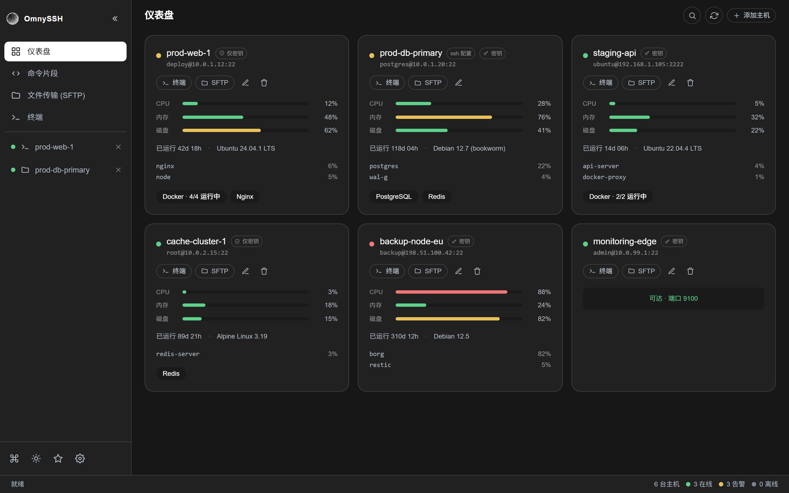

<div align="center">

# OmnySSH 简体中文版

### 现代化 TUI / GUI SSH 服务器管理工具 —— 仪表盘、终端、SFTP、命令片段全集成

<a href="https://github.com/AnonyJcy/omnyssh-cn">
  
</a>

[](LICENSE)
[](https://github.com/AnonyJcy/omnyssh-cn/stargazers)
[]()
[]()

</div>

---

## 项目简介

**OmnySSH 简体中文版** 是基于官方上游 [timhartmann7/omnyssh](https://github.com/timhartmann7/omnyssh) 深度定制的中文本地化分支。

本项目引入了轻量级、无侵入的 **多语言国际化（i18n）架构**，内置全套简体中文（zh-CN）语言包，并配置了 **GitHub Actions 每日自动同步官方上游代码** 的自动化流水线，保持官方最新特性的同时享受舒适的中文界面。

---

## 主要功能特性

- **实时服务器仪表盘**：单个窗口统一监控多台 VPS/服务器，直观展示 CPU、内存、磁盘使用率、运行时间、操作系统、活跃进程及 Docker 等服务状态；支持按标签分组、按名称或状态排序，桌面端还可拖拽或通过键盘调整卡片顺序。
- **内置多标签终端 (PTY)**：基于 xterm 的高性能终端，支持多会话与后台无缝切换；终端断开后保留最后输出，退出时可确认仍在运行的任务。
- **双栏式 SFTP 文件传输**：左侧本地、右侧远程，支持文件及整目录批量上传、下载、双栏拖拽和从系统文件管理器拖入，显示修改时间，支持覆盖确认、进度显示和取消传输；保留可编辑地址栏、常用位置快捷入口及 Windows 快捷方式过滤。
- **命令片段与多机广播**：保存高频 Shell 运维命令，支持动态参数插值（`{{service}}`），并支持一键向选中的多台服务器并发广播执行。
- **自动化 SSH 密钥免密配置**：确认后生成 Ed25519 密钥、分发公钥并验证连接；具备免密码 sudo 权限时可禁用服务器密码认证。界面明确区分密码仍开启、完整成功、已回滚及密码可能仍关闭的失败状态，并保留一键恢复密码登录功能。
- **⌘K 全局快速命令面板**：键盘驱动，快速搜索与切换主机和活动会话。
- **主播/隐私模式 (Streamer Mode)**：隐藏敏感主机信息，并脱敏错误消息和主机表单地址；可通过状态栏、命令面板或 `⌘⇧S` / `Ctrl+Shift+S` 切换，适合录屏与直播演示。
- **主题与多语言随时切换**：内置浅色和深色主题，可在设置中切换 **简体中文** 与 **English**，并查看与复制已安装版本。

---

## 安装与使用

### GUI 桌面客户端

前往 [**Releases 发行版页面**](https://github.com/AnonyJcy/omnyssh-cn/releases) 下载对应平台的安装包：

| 操作系统平台 | 文件格式 | 说明 |
|-------------|----------|------|
| **Windows x86_64** | `OmnySSH-x86_64-setup.exe` / `OmnySSH-x86_64.zip` | 64 位 Windows 安装版 / 便携版；便携版需已安装 WebView2 Runtime |
| **macOS (Apple Silicon)** | `OmnySSH-aarch64-apple-darwin.dmg` | 适用于 M1/M2/M3/M4 系列芯片 |
| **macOS (Intel)** | `OmnySSH-x86_64-apple-darwin.dmg` | 适用于 Intel 处理器 Mac |
| **Linux x86_64** | `OmnySSH-x86_64.AppImage` / `.deb` / `.rpm` | 通用 Linux 发行版 |

> **无账号、无遥测、无数据上传**：应用本地运行，自动读取你的 `~/.ssh/config` 配置，隐私安全。

支持加密私钥：应用仅在需要时询问私钥密码（Passphrase），保留在内存中直到退出，绝不写入磁盘。macOS 和 Linux 上已加载到 `ssh-agent` 的密钥无需再次询问。主机表单中的**密码**指服务器登录密码，不是私钥密码。

---

## 自动化同步与维护

本项目通过 GitHub Actions 实现了与官方上游仓库的自动化跟踪：
1. **每日定时同步**：北京时间每天 10:00 自动检查并合并官方 `main` 分支的最新提交。
2. **语言包独立维护**：翻译字典存放在 `$lib/i18n/locales/`。当上游同时改动已汉化的界面或本分支扩展功能时，仍需人工解决冲突；同步任务会失败并保留当前分支，避免覆盖汉化。

---

## TUI 终端版


终端版与 GUI 共用同一个 SSH 引擎，支持仪表盘、SFTP、命令片段、多会话、模糊搜索、四种主题及自定义快捷键。

官方上游 TUI 可通过以下方式安装（这些命令安装官方终端版，而非本分支的中文 GUI）：

```bash
cargo install omnyssh
brew install timhartmann7/tap/omnyssh
nix run github:timhartmann7/omnyssh
```

运行 `omny`，按 `a` 添加主机、`/` 搜索、`g` 按标签分组、`?` 查看帮助、`Shift+K` 配置所选主机的密钥。完整选项和配置示例见 `man omny`。

上游 [Releases](https://github.com/timhartmann7/omnyssh/releases) 也提供 `omny-*` 预编译终端版。配置目录：Linux 为 `~/.config/omnyssh/`，macOS 为 `~/Library/Application Support/omnyssh/`，Windows 为 `%APPDATA%\omnyssh\`。启动时会读取 `~/.ssh/config`，不会写入原配置文件。

---

## 致敬原作者与开源协议

- **官方上游仓库**：[timhartmann7/omnyssh](https://github.com/timhartmann7/omnyssh)
- **开源协议**：[Apache License 2.0](LICENSE)
- 感谢原作者 **Tim Hartmann**（[@timhartmann7](https://github.com/timhartmann7)）打造的开源工具。

---

## 常见问题排查 (Troubleshooting)

- **macOS：局域网主机连接提示 "No route to host"**：macOS 默认限制应用访问本地局域网设备。请前往系统设置 → 隐私与安全性 → 本地网络 (Local Network)，允许 OmnySSH 访问后重启应用即可。
- **群晖 (Synology NAS)：终端输入密码后提示 "Permission denied, please try again." 并退出**：Synology DSM 默认仅向管理员群组（administrators）账户分配 Shell 终端权限，普通用户登录将被拒绝并断开，但 SFTP 文件传输仍可正常使用。

<div align="center">

### ⭐ 如果 OmnySSH 对你有帮助，欢迎在 GitHub 上点个 Star！

[提交问题反馈](https://github.com/AnonyJcy/omnyssh-cn/issues) •
[功能需求建议](https://github.com/AnonyJcy/omnyssh-cn/issues) •
[官方项目原址](https://github.com/timhartmann7/omnyssh)

</div>
