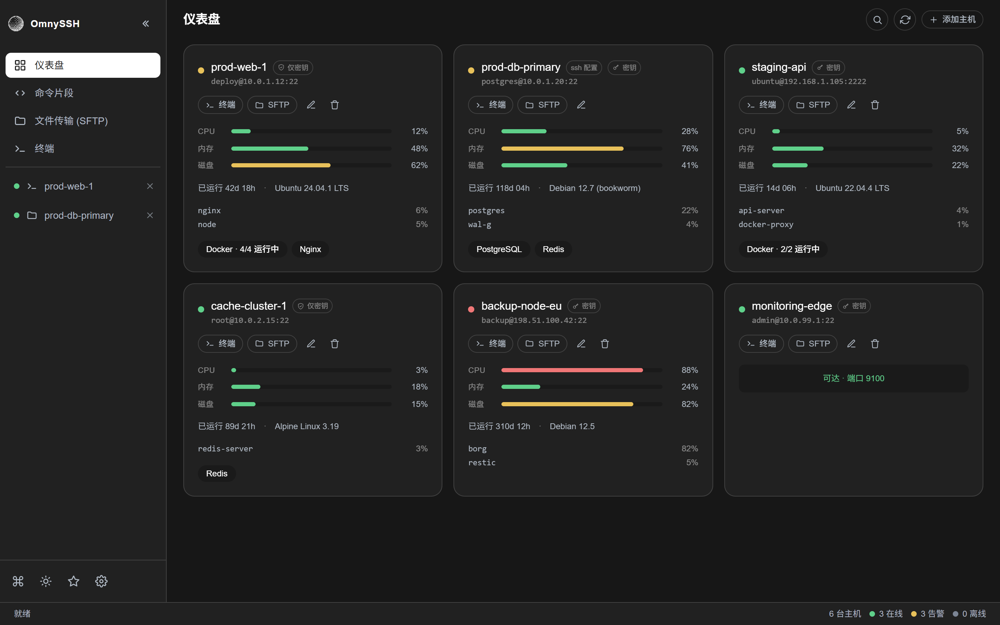

> [!IMPORTANT]
> ## 本项目已迁移至 **[KoraSSH](https://github.com/AnonyJcy/korassh)**
>
> OmnySSH 中文维护版已升级为独立品牌 **KoraSSH**，并在新仓库继续维护；本仓库自 `v1.1.11` 起不再更新。
>
> - **前往下载**：[KoraSSH 最新版本](https://github.com/AnonyJcy/korassh/releases/latest)
> - **配置自动迁移**：KoraSSH 首次启动会自动把这里的 `hosts.toml` / `snippets.toml` / `config.toml` 与桌面端设置复制过去（不改动旧目录），并把明文密码升级为 AES-256-GCM 加密存储。
> - **应用内提示**：升级到 `v1.1.11` 后，终端版与桌面端的更新检查会直接引导前往 KoraSSH 的发布页。两者是不同的应用（名称、标识与配置目录均不同），所以不会原地自更新。

<div align="center">

# OmnySSH（中文维护版）

本地优先的 SSH 服务器监控仪表盘、多标签终端与 SFTP 客户端（桌面端 GUI + 终端 TUI）

<a href="https://github.com/AnonyJcy/omnyssh-cn">
  
</a>

[](https://github.com/AnonyJcy/omnyssh-cn/releases)
[](LICENSE)
[]()
[]()

</div>

---

## 关于本项目

这个项目最初从 [timhartmann7/omnyssh](https://github.com/timhartmann7/omnyssh) 分支出来，最早只是为了做个简体中文版。原仓库在 v1.1.5 之后就较少有新动静了，现在主要由 [@AnonyJcy](https://github.com/AnonyJcy) 持续接手维护和发版，相当于作为一个独立版本继续往前做。

核心原则还是和原来一样：**所有数据留在本地，没有账号系统，没有任何遥测，只读解析 `~/.ssh/config`**。在这个前提下，后面的更新主要围绕补上实际用得上的功能、消化原仓库一直挂着没合并的社区 PR，以及顺手解决 Windows 和中文环境下不好用的地方。

### 相比原版，这里多做了什么

**自己动手加的功能与改动**

- **一键恢复密码登录**：用密钥工具关掉服务器密码登录后，卡片上直接留了「恢复密码登录」的退路。改配置前先自动备份 `/etc/ssh/sshd_config`，也会处理云主机常见的 `/etc/ssh/sshd_config.d/*.conf`，改完用 `sshd -t` 验一遍语法，出错就自动回滚，不会动到原本配好的公钥和 `authorized_keys`。
- **SFTP 本地侧顺手一些**：打开默认直接落在「桌面」（没有桌面目录再回退主目录），点击路径栏能直接敲路径或粘贴跳转，旁边加了常用文件夹快捷按钮；针对 Windows 桌面容易堆满 `.lnk` 快捷方式的问题，默认先藏起来，工具栏里随时能点开看。
- **把 Windows 下的刷新修好**：桌面端用的是 WebView2，以前按 `F5` 或 `Ctrl+R` 会把整个页面刷白、把开着的终端和 SFTP 全弄丢，现在改成了页面内安全刷新（终端里的 `Ctrl+R` 搜索历史照常留给远程 Shell）；另外以前主机连失败后点刷新没反应，现在只要有失败或未知状态的主机，点刷新或按 `F5`/`R` 会直接唤醒重连，不用干等后台退避时间。
- **中文显示与字体切换**：补全了中英文双语切换；全平台包保持约 5MB 轻量体积、默认直接走系统字体（零外网请求）。在「设置 → 外观」中接入了华为可商用的 **鸿蒙黑体（HarmonyOS Sans）** 一键切换（优先检测本机是否已安装，未安装时再按需在线拉取字形子集并本地缓存），同时也支持切换终端等宽字体或填本机任意字体，并留着 Nerd Font 图标回退。
- **独立编译与安装向导汉化**：单独维护整套跨平台构建与 Release 更新链路，Windows 的 `.exe` 安装与卸载向导已直接汉化为简体中文界面。

**合入并适配的社区 PR**

原仓库里积压了几个很实用的社区 PR 一直没合，这边逐个看代码、解冲突、补好中英文和测试用例之后也一并带进来了：
- **终端输出搜索**（PR #152）：桌面端终端支持 `⌘F` / `Ctrl+Shift+F` 检索回滚输出，支持高亮计数、大小写与正则匹配。
- **PuTTY 风格复制与粘贴**（PR #162）：划选自动复制、鼠标右键/中键粘贴、`Ctrl+Shift+A` 复制全屏历史，以及多行文本粘贴确认弹窗防误执行。
- **远程 Windows 主机监控**（PR #138）：无需在远程安装任何 Agent，连上 Windows OpenSSH 后自动识别平台，通过非交互式 PowerShell CIM 采集 CPU、内存、系统盘、运行时间及高负载进程。

---

## 核心功能

- **多平台服务器仪表盘**：单窗口监控 Linux、macOS、FreeBSD 与远程 Windows 主机；支持按标签分组、按名称/状态排序，卡片支持拖拽与键盘调整顺序。
- **多标签终端 (PTY)**：基于 xterm 构建，支持多会话并存、断线后保留最后输出防止报错闪退、关闭软件前对仍在运行的任务进行二次确认。
- **双栏 SFTP 文件传输**：支持整目录批量上传下载、双栏互拖、从系统文件管理器直接拖入上传、保留文件权限位，以及随时取消传输。
- **命令片段与多机广播**：保存常用运维指令并支持 `{{param}}` 参数插值，一次并发下发到多台选定服务器。
- **本地端口转发（SSH 隧道）**：图形化配置或自动同步 `LocalForward`，支持一键启停、开机自启与断线自动重连。
- **自动密钥部署与私钥管理**：自动生成 Ed25519 密钥并写入服务器，加密私钥仅在内存中临时解锁；提供仅测 TCP 端口连通性的模式，适合无法执行 Shell 命令的交换机/防火墙等设备。
- **隐私（主播）模式与命令面板**：`⌘⇧S` / `Ctrl+Shift+S` 一键脱敏主机名、IP、表单与错误提示中的地址信息；`⌘K` / `Ctrl+K` 全局键盘快速搜索主机与切屏。

---

## 下载与安装

### 直接下载（推荐）

前往 [**Releases 页面**](https://github.com/AnonyJcy/omnyssh-cn/releases) 下载对应系统的版本（所有产物均由本仓库 GitHub Actions 自动编译并附带 `SHA256SUMS` 校验文件）：

| 平台 | 桌面端 GUI | 终端版 TUI (`omny`) | 说明 |
|---|---|---|---|
| **Windows x86_64** | `OmnySSH-x86_64-setup.exe` / `OmnySSH-x86_64.zip` | `omny-x86_64-pc-windows-msvc.zip` | 安装版为简体中文向导；便携版需系统已装 WebView2 Runtime |
| **macOS (Apple Silicon)** | `OmnySSH-aarch64-apple-darwin.dmg` | `omny-aarch64-apple-darwin.tar.gz` | 适用于 M 系列芯片（首次打开若受拦截需在隐私与安全性中放行） |
| **macOS (Intel)** | `OmnySSH-x86_64-apple-darwin.dmg` | `omny-x86_64-apple-darwin.tar.gz` | 适用于 Intel 处理器 Mac |
| **Linux x86_64** | `OmnySSH-x86_64.AppImage` / `.deb` / `.rpm` | `omny-x86_64-unknown-linux-gnu.tar.gz` | 通用桌面包与静态/动态终端包 |
| **Linux ARM64 / Termux** | — | `omny-aarch64-unknown-linux-musl.tar.gz` | musl 静态链接，可直接运行于 Android Termux 与各类 ARM 服务器 |

### 一键安装脚本（Linux / macOS / Git Bash）

```bash
# 安装桌面端（ARM64 Linux 或 Termux 下会自动回退安装终端版 omny）
curl -fsSL https://raw.githubusercontent.com/AnonyJcy/omnyssh-cn/zh-cn/install.sh | sh

# 仅安装终端版 omny
curl -fsSL https://raw.githubusercontent.com/AnonyJcy/omnyssh-cn/zh-cn/install.sh | sh -s -- --tui

# 同时安装桌面端和终端版
curl -fsSL https://raw.githubusercontent.com/AnonyJcy/omnyssh-cn/zh-cn/install.sh | sh -s -- --both
```

### 从源码构建

如果只需要命令行终端版（不依赖 Node.js 与 WebView 环境）：

```bash
cargo build --release --locked
# 产物位于 target/release/omny
```

如需构建桌面端 GUI，在完成 `crates/omnyssh-gui/ui` 下的 `npm ci` 后通过 Tauri CLI 编译即可，具体可参考 [.github/workflows/release.yml](.github/workflows/release.yml)。

---

## 使用说明与常见问题

### 配置文件位置

软件启动时会读取 `~/.ssh/config`（只读不改写），自己在面板中添加或编辑的主机副本、命令片段与通用配置存放在各系统默认目录：
- **Windows**：`%APPDATA%\omnyssh\`
- **macOS**：`~/Library/Application Support/omnyssh/`
- **Linux**：`~/.config/omnyssh/`

> **关于密码与私钥**：主机表单中的「密码」用于服务器登录认证；加密私钥的 Passphrase 仅在解锁时保留在进程内存中，退出即销毁，不会落盘。

### 终端版 (`omny`) 常用键位


运行 `omny` 后，按 `a` 添加主机、`/` 搜索、`g` 按标签分组、`r` 强制刷新与重连、`Shift+K` 配置 SSH 密钥、`?` 打开键位帮助，详细说明见 `man omny`。

### 常见问题

- **macOS 连接局域网主机提示 `No route to host`**：macOS 默认拦截应用访问本地局域网。前往「系统设置 → 隐私与安全性 → 本地网络」，勾选允许 OmnySSH 后重启应用即可。
- **群晖 Synology NAS 终端输入密码后提示 `Permission denied, please try again.`**：Synology DSM 默认仅允许 `administrators` 群组账号开启 Shell 终端，普通账号无法打开终端，但 SFTP 文件管理可正常使用。
- **Windows 便携版无法打开窗口**：`OmnySSH-x86_64.zip` 体积小巧但不自带 WebView2 运行时。如精简版系统缺失 WebView2，建议直接下载运行 `OmnySSH-x86_64-setup.exe` 安装程序，它会自动引导补齐运行环境。

---

## 维护说明与致谢

- 仓库保留了向上游同步合入的自动化工作流（[.github/workflows/sync-upstream.yml](.github/workflows/sync-upstream.yml)），用于检查上游是否发布新的关键修复；日常版本发布与功能开发以 `zh-cn` 主分支为准。
- 感谢原作者 **Tim Hartmann**（[@timhartmann7](https://github.com/timhartmann7)）打下的架构基础，以及社区 PR 贡献者 [@olcums](https://github.com/olcums)（#138）、[@sachin56](https://github.com/sachin56)（#152）与 [@alez0101](https://github.com/alez0101)（#162）。
- 本项目基于 [Apache License 2.0](LICENSE) 开源；内置字体遵循华为 HarmonyOS Sans Fonts License 协议免费商用。

欢迎在使用中通过 [GitHub Issues](https://github.com/AnonyJcy/omnyssh-cn/issues) 反馈 Bug 或交流使用需求。
